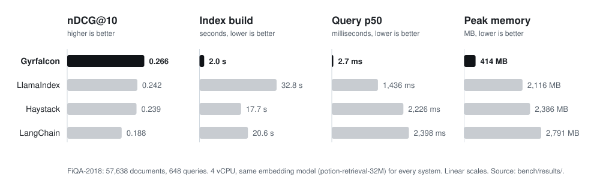
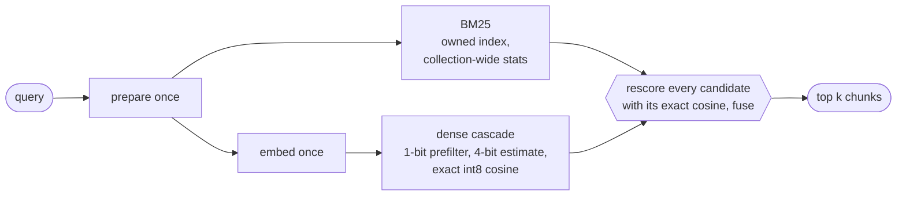

<div align="center">

<picture>
  <source media="(prefers-color-scheme: dark)" srcset="docs/assets/logo-dark.png">
  
</picture>

<h3>Hybrid retrieval for RAG, fast on any CPU.</h3>

BM25 and dense vector search over the same chunks, fused, in one Rust engine.<br>
No server, no vector database, no GPU, and a default tier that needs no model runtime.

<br>

[](https://github.com/lucasdmarshall/gyrfalcon/actions/workflows/ci.yml)
[](LICENSE)
[](docs/reference/rust-api.md)
[](docs/reference/python-api.md)
[](#roadmap)

[**Quickstart**](#quickstart) · [**Benchmarks**](#benchmarks) · [**How it works**](#how-it-works) · [**Documentation**](docs/README.md) · [**Design records**](docs/README.md#design-records)

</div>

<br>

<div align="center">
<table>
  <tr>
    <td align="center" width="200"><h2>0.266</h2>nDCG@10 on FiQA<br><sub>highest of four frameworks</sub></td>
    <td align="center" width="200"><h2>2.0 s</h2>to index 57,638 docs<br><sub>9 to 16x faster</sub></td>
    <td align="center" width="200"><h2>2.7 ms</h2>query latency, p50<br><sub>over 500x faster</sub></td>
    <td align="center" width="200"><h2>414 MB</h2>peak memory<br><sub>5 to 7x less</sub></td>
  </tr>
</table>
</div>

<p align="center"><sub>Lite tier against LlamaIndex, LangChain, and Haystack, same embedding model, 4 vCPU. <a href="#benchmarks">Details below.</a></sub></p>

## Quickstart

```sh
pip install gyrfalcon-rag       # import gyrfalcon; add [pdf] for PDFs, [full] for the transformer tier
```

```python
from gyrfalcon import Collection

with Collection("./my-index") as col:                 # created on first use
    col.add_path("docs/")                              # PDF, HTML, Markdown, and text files
    col.add("note-1", "Gyrfalcons are the largest falcons.", metadata={"topic": "birds"})

    for hit in col.search("largest falcon", k=5, filter={"topic": "birds"}):
        print(f"{hit.score:.3f}  {hit.doc_id}  {hit.text[:80]}")
```

The model (130 MB) downloads on first use. Every write is durable when the call returns, and the
next search sees it. `update` replaces a document atomically; `delete` removes it.

<details>
<summary><b>Command line</b></summary>

<br>

```sh
cargo install --git https://github.com/lucasdmarshall/gyrfalcon gyr-cli
scripts/fetch-models.sh                            # from a clone: models into .models/

gyr index ./my-index docs/ --metadata source=handbook
gyr query ./my-index "largest falcon" --filter source=handbook
gyr serve ./my-index                               # HTTP API on 127.0.0.1:7700
```

</details>

<details>
<summary><b>Rust</b></summary>

<br>

```sh
cargo add gyrfalcon --git https://github.com/lucasdmarshall/gyrfalcon
```

```rust
use std::path::Path;
use gyrfalcon::{Document, Filter, RetrieveOptions, Tier};

fn main() -> gyrfalcon::Result<()> {
    let models = Path::new(".models").join(Tier::Lite.model_dir());
    let mut index = Tier::Lite.open(Path::new("my-index"), &models, true)?;

    index.index_documents(&[
        Document::body("falcon", "The gyrfalcon is the largest falcon.").with_metadata([("topic", "birds")]),
    ])?;

    let birds = Filter::new().eq("topic", "birds");
    let hits = index.retrieve_filtered("largest falcon", RetrieveOptions::default(), Some(&birds))?;
    for hit in &hits.hits {
        println!("{:.3}  {}  {}", hit.score, hit.doc_id, hit.body);
    }
    Ok(())
}
```

</details>

<details>
<summary><b>HTTP</b></summary>

<br>

```sh
curl -X POST localhost:7700/v1/documents \
  -d '{"documents": [{"doc_id": "falcon", "text": "The gyrfalcon is the largest falcon."}]}'
curl -X POST localhost:7700/v1/retrieve -d '{"query": "largest falcon", "limit": 5}'
curl -X PUT  localhost:7700/v1/documents/falcon -d '{"text": "Gyrfalcons breed in the Arctic."}'
```

Every endpoint is in the [configuration reference](docs/reference/configuration.md#http-api).

</details>

Already using LangChain or LlamaIndex? A twenty-line adapter makes a collection their retriever:
[from LangChain](docs/guides/migrating-from-langchain.md) ·
[from LlamaIndex](docs/guides/migrating-from-llamaindex.md).

## Benchmarks

Each framework builds its standard hybrid retriever (BM25 plus dense, fused) over the same BEIR
data with the same embedding model, on the same 4-vCPU cloud VM.



### Lite tier, all four datasets

| nDCG@10 | Gyrfalcon | LlamaIndex | LangChain | Haystack |
|:---|---:|---:|---:|---:|
| SciFact | **0.709** | 0.695 | 0.604 | 0.674 |
| NFCorpus | **0.344** | 0.308 | 0.254 | 0.327 |
| ArguAna | **0.491** | 0.473 | 0.387 | 0.441 |
| FiQA | **0.266** | 0.242 | 0.188 | 0.239 |

| Query p50 | Gyrfalcon | LlamaIndex | LangChain | Haystack |
|:---|---:|---:|---:|---:|
| SciFact | **1.7 ms** | 108 ms | 116 ms | 166 ms |
| NFCorpus | **1.6 ms** | 79 ms | 69 ms | 117 ms |
| ArguAna | **2.1 ms** | 190 ms | 666 ms | 534 ms |
| FiQA | **2.7 ms** | 1,436 ms | 2,398 ms | 2,226 ms |

### Full tier (bge-small-en-v1.5), SciFact

| | Gyrfalcon | LlamaIndex | LangChain | Haystack |
|:---|---:|---:|---:|---:|
| nDCG@10 | **0.743** | 0.727 | 0.639 | 0.714 |
| Index build | **193 s** | 1,251 s | 636 s | 657 s |
| Query p50 | **9.1 ms** | 159 ms | 137 ms | 167 ms |
| Peak memory | **499 MB** | 1,520 MB | 1,513 MB | 1,451 MB |

<details>
<summary><b>One core, held-out datasets, and run-to-run variance</b></summary>

<br>

**One core.** Every process pinned to a single core: SciFact indexes in **0.9 s** against 7.1 to
18.6 s, and queries take **2.2 ms** against 110 to 177 ms.

**Held-out datasets.** Four BEIR sets that were never used to choose any setting. Lite tier,
Gyrfalcon configured, nDCG@10:

| TREC-COVID | SciDocs | Quora | Touché-2020 |
|:---:|:---:|:---:|:---:|
| 0.680 | 0.165 | 0.834 | 0.318 |

On the same sets, with reciprocal rank fusion, Haystack scores 0.334 on Touché-2020, ahead of
both Gyrfalcon rules (0.318 configured, 0.309 RRF). Gyrfalcon RRF is 0.631 on TREC-COVID, below
LlamaIndex at 0.636; configured still leads that set at 0.680. Quora's framework cells are a
200-query sample, not the full 10,000. The
[table](docs/benchmarks/results.md#same-rule-comparison-on-all-eight-sets) has every cell.

**Variance.** Five back-to-back runs over eight datasets: nDCG@10 identical to every digit, p50
within 1.5x across runs, p99 under 12 ms at the median on every set
([table](docs/benchmarks/results.md#run-to-run-variance)).

</details>

> [!IMPORTANT]
> Gyrfalcon's fusion weights were chosen on validation queries of the tuning datasets; the other
> frameworks run their defaults.[^tuned] With the same fusion rule, Gyrfalcon's full tier and
> LlamaIndex tie on SciFact (0.727). The speed and memory gaps do not depend on tuning.
> Read the [methodology and disclosures](docs/benchmarks/methodology.md) before quoting a number.

Reproduce everything with one command: `scripts/reproduce.sh lite` or `scripts/reproduce.sh compare`
([Reproducing](docs/benchmarks/reproducing.md)). Raw reports are in [`bench/results/`](bench/results/).

## How it works



- **One prepare, two legs.** A query is normalized and analyzed once; BM25 and the dense search
  run in parallel on the same text.
- **An owned BM25 index.** Bit-packed postings with block skip data, scores identical to Tantivy's,
  stemming and stopwords, statistics summed across segments so a chunk scores the same wherever
  it lives.
- **A graph-free dense index.** Sign-bit codes of rotated vectors, a Hamming prefilter, a 4-bit
  estimate, and an exact int8 rescore. It finds 0.996 to 1.000 of the exact top 50 with no graph to
  build, which is why indexing is fast.
- **Rescore fusion.** Every candidate from either leg gets its exact cosine, so a chunk only BM25
  found is not penalized. The lite tier mixes the scores as

$$
\text{score}(d) \;=\; (1-w)\,\frac{\mathrm{BM25}(d)}{\max_{d'} \mathrm{BM25}(d')} \;+\; w\,\cos(q, d), \qquad w = 0.45
$$

- **Writes that survive crashes.** Small writes go to a write-ahead log and an in-memory buffer
  that queries see at once; larger ones seal immutable segments that merge in the background. Every
  state change is one atomic rename. Updates replace a document in one step.

The full design, with the measurement behind every decision, is in
[Architecture](docs/concepts/architecture.md) and the [design records](docs/README.md#design-records).

## Two tiers

| | `lite` (default) | `full` |
|:---|:---|:---|
| Embedder | potion-retrieval-32M, a static table | bge-small-en-v1.5, int8 transformer |
| Needs | nothing | ONNX Runtime (`pip install "gyrfalcon-rag[full]"`) |
| Index speed | 15,000 to 30,000 docs/s on 4 cores | about 25 docs/s on 4 cores |
| Best for | large or changing corpora, small machines | corpora where quality outweighs ingest time |

Start with `lite`; moving to `full` is one argument and a rebuild.
[Choosing a tier](docs/guides/choosing-a-tier.md) has the trade-off in numbers.

## Features

<table>
  <tr>
    <td width="50%" valign="top">
      <b>Files in, chunks out</b><br>
      PDF through PDFium with a layout layer that removes running headers and page numbers and
      rejoins hyphenated words. HTML by its block structure. Markdown and text as they are.
    </td>
    <td width="50%" valign="top">
      <b>Metadata filters</b><br>
      <code>filter={"lang": "en", "tag": ["a", "b"]}</code>. Applied inside both legs, so a selective
      filter still returns a full top k.
    </td>
  </tr>
  <tr>
    <td valign="top">
      <b>Durable and atomic</b><br>
      Writes are fsynced before a call returns. An update's new chunks and the removal of its old
      ones commit together. A crash loses at most the write in flight.
    </td>
    <td valign="top">
      <b>Never blocks readers</b><br>
      Queries read a snapshot. Merges build outside the writer lock, and retired files are
      deleted in the background once no query needs them.
    </td>
  </tr>
  <tr>
    <td valign="top">
      <b>One format, four interfaces</b><br>
      Python, Rust, the <code>gyr</code> command line, and an HTTP server open the same
      collections. Models load at run time; nothing is linked at build time.
    </td>
    <td valign="top">
      <b>Safe by construction</b><br>
      A collection records its model, vector width, and analyzer. Opening it with anything else
      fails before a file is mapped, instead of returning plausible wrong results.
    </td>
  </tr>
</table>

## Documentation

| Section | Pages |
|:---|:---|
| **Getting started** | [Installation](docs/getting-started/installation.md) · [Python quickstart](docs/getting-started/quickstart-python.md) · [Rust quickstart](docs/getting-started/quickstart-rust.md) |
| **Guides** | [Choosing a tier](docs/guides/choosing-a-tier.md) · [Large corpora](docs/guides/indexing-large-corpora.md) · [Custom embedders](docs/guides/custom-embedders.md) · [Persistence](docs/guides/persistence.md) |
| **Concepts** | [Architecture](docs/concepts/architecture.md) · [Hybrid retrieval](docs/concepts/hybrid-retrieval.md) · [Tiers](docs/concepts/tiers.md) · [Planner](docs/concepts/planner.md) |
| **Reference** | [Python API](docs/reference/python-api.md) · [Rust API](docs/reference/rust-api.md) · [Configuration and HTTP](docs/reference/configuration.md) |
| **Benchmarks** | [Results](docs/benchmarks/results.md) · [Methodology](docs/benchmarks/methodology.md) · [Reproducing](docs/benchmarks/reproducing.md) |

## Roadmap

- [x] Owned BM25 index and graph-free dense index
- [x] Python package, command line, HTTP server
- [x] PDF and HTML ingestion, metadata filters
- [x] Held-out evaluation and run-to-run variance
- [ ] First release on PyPI and crates.io
- [ ] Pruned BM25 and partitioned dense search for collections past a million chunks
- [ ] Adaptive per-query planning ([design](docs/concepts/planner.md))
- [ ] Corpus distillation for the lite tier ([v2 design](docs/v2-beta/corpus-distillation.md))

## Contributing

Bug reports, fixes, and measured improvements are welcome. Read
[Contributing](docs/contributing/CONTRIBUTING.md) for how changes are judged, then
[Development setup](docs/contributing/development-setup.md) and [Testing](docs/contributing/testing.md).

## License

Licensed under the [Apache License 2.0](LICENSE). Changes for each version are in [CHANGELOG.md](CHANGELOG.md).

[^tuned]: Weights were chosen on validation splits of SciFact, NFCorpus, ArguAna, FiQA, and Open
    RAG Bench, which use different queries from the reported test splits over the same documents.
    The four held-out datasets above had no part in any choice.
