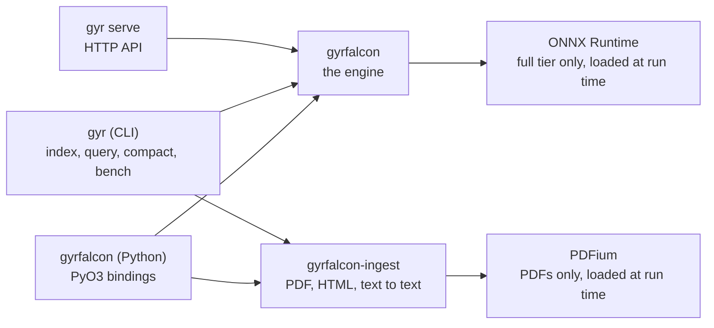
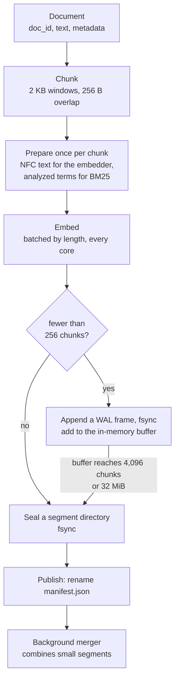
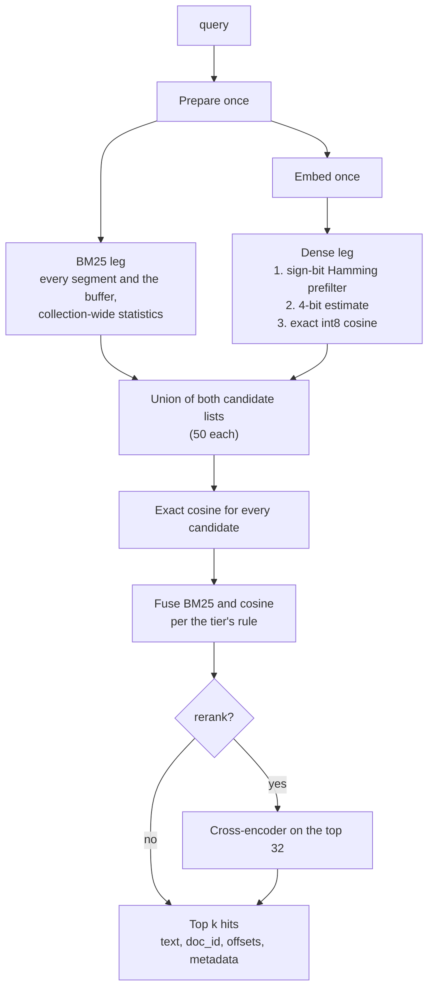
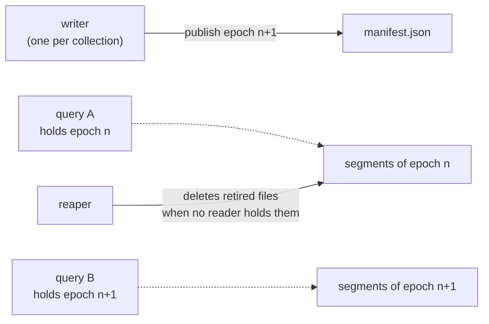

[Docs](../README.md) / Concepts

# Architecture

Gyrfalcon is a library first. The engine is one Rust crate; the Python package, the command line,
and the HTTP server are thin layers that decode their input and call it. This page follows a
document from the moment it is added to the moment it is returned by a query, and explains the
choices along the way.

## Components

| Crate | Role |
|---|---|
| `gyrfalcon` | Chunking, text analysis, embedding, the BM25 and dense indexes, fusion, segments, the write-ahead log, merges |
| `gyrfalcon-ingest` | Files to text: PDF through PDFium plus a layout layer, HTML by its block structure, text as is |
| `gyr-cli` | The `gyr` binary, the HTTP server, and the benchmark harness |
| `gyrfalcon-py` | The Python package |

The engine has no network service, no database, and no model runtime of its own. The lite tier
needs no native library at all; ONNX Runtime and PDFium are loaded only when a full-tier
collection or a PDF needs them.

## The write path

1. **Chunking.** The text is cut into windows of 2,048 bytes that overlap by 256. A cut prefers
   a blank line, then a newline, then a sentence end, looked for first in the back half of the
   window so a heading near the start does not leave a fragment. No cut splits a UTF-8
   character, and every byte is covered.
2. **Preparation.** Each chunk is normalized once (Unicode NFC, trimmed, case kept) and that one
   string feeds both indexes. The embedder sees it as written. The BM25 analyzer, `gyr-text-v2`,
   splits it on anything that is not a letter or digit, lowercases, drops 33 English stopwords,
   and stems ASCII words with the Snowball English stemmer; other scripts, numbers, and
   identifiers such as `e0308` pass through unchanged. A chunk keeps each distinct term once
   with its count, which is all BM25 needs.
3. **Embedding.** Texts are sorted by length and embedded in batches on every core. For the
   lite tier this is a table lookup per token. For the full tier, batches are capped at 8 KB of
   text, because a transformer pads each batch to its longest text and its memory grows with
   the square of that length.
4. **Storage.** A small write is appended to the write-ahead log and fsynced (about 0.3 ms), then
   joins an in-memory buffer that queries search immediately. A large write, or a full buffer,
   becomes a sealed segment: an immutable directory with its own BM25 index and vectors.
5. **Publishing.** A new state becomes visible through one atomic rename of `manifest.json`.
   Every file it names is fsynced first. A crash before the rename leaves the old state intact;
   after it, the new one.
6. **Merging.** A background thread merges eight small segments of the same size class into one
   once they hold at most 100,000 chunks in total, and rewrites a large segment alone when more
   than 20% of it has been deleted. Merges build outside the writer lock and publish by the same
   rename. Chunk ids never change.

## The read path

1. **Prepare once.** The query goes through the same normalization and analyzer as the chunks,
   once. The same string feeds both legs.
2. **Both legs in parallel.** The BM25 leg runs on one thread while the other embeds the query
   and runs the dense leg.
3. **BM25.** Each segment holds its own postings, but scores use collection-wide statistics:
   the document frequency of a term is the sum over every segment's dictionary and the buffer.
   So a chunk scores the same whichever segment it sits in, and before and after a merge.
   Scoring is exhaustive and term at a time, bit-compatible with Tantivy's BM25 (`k1` 1.2,
   `b` 0.75). A query term repeated n times counts n times.
4. **Dense.** There is no graph. Each vector is stored twice: as int8, and as the sign bits of
   its rotated residual (a RaBitQ-style code). A query first ranks every live row by Hamming
   distance on those bits (about 3 ns per row), keeps a few thousand, estimates their cosine
   from a 4-bit query, and computes the exact int8 cosine for the best of those. Against an
   exact scan this finds 0.996 to 1.000 of the true top 50.
5. **Fusion.** Every candidate from either leg gets its exact cosine from its stored vector, so a
   chunk that only BM25 found is not penalized on the dense side. The two scores are combined
   with the tier's rule; see [Hybrid retrieval](hybrid-retrieval.md).
6. **Results.** The top `k` are read from the segments' stored text with their document id,
   byte offsets, and metadata.

Deleted chunks and chunks outside a metadata filter are excluded inside both legs, during the
scan. They never take a slot in a top-k list, so a query never comes back short because of them.

### Where the time goes

FiQA (57,638 documents) on the lite tier, 4 cores, p50 2.7 ms per query
(`bench/results/2026-10-26-quality-sweep`, spec "Owned BM25 index" and "Graph-free dense index"):

| Step | Approximate cost |
|---|---|
| Prepare the query | about 0.01 ms |
| Embed (lite, static table) | tens of microseconds |
| BM25 leg | about 0.9 ms (mean) |
| Dense leg | 0.6 to 0.75 ms |
| Exact cosine for candidates, fusion, reading hit text | the remainder |

The two legs overlap in time. With the full tier the transformer pass on the query dominates:
SciFact's p50 rises from 1.7 ms to 9.1 ms.

## Consistency and concurrency

- **One writer process.** Opening a collection takes `writer.lock`. Inside that process, any
  number of threads can query while writes and merges proceed.
- **Snapshots.** A query takes the current published state (an epoch) and keeps it until it
  returns. A merge that publishes meanwhile does not disturb it.
- **Deferred deletes.** Files a merge retires are deleted only after every query that may read
  them has finished, on a background thread and outside every lock queries take, so no query
  waits on the file system. On Windows, where a mapped file cannot be deleted, a failed delete
  stays queued and is retried on the next write.
- **Tombstones.** Deletes and updates never rewrite a sealed segment. They add chunk ids to a
  collection-wide tombstone set; the ids leave the files when a merge rewrites the segment.
  BM25 statistics keep counting dead chunks until then, as Lucene does, so no query has to
  scan postings to subtract them.

## Identity

Each collection records the model id, vector width, quantization, analyzer, and format version
it was built with. Every open compares them first, before any file is mapped or model loaded,
and refuses a mismatch. A collection therefore cannot be queried with vectors from another
model, or with terms from another analyzer, by accident. See [Tiers](tiers.md).

## Further reading

- [Hybrid retrieval](hybrid-retrieval.md): the two legs and the fusion rules in detail.
- [Persistence](../guides/persistence.md): files, durability, backups.
- [The design specification](../superpowers/specs/2026-10-24-gyrfalcon-design.md): every format
  change, with the measurements that justified it.

---

Next: [Hybrid retrieval](hybrid-retrieval.md)
