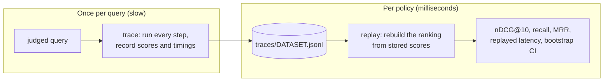

<sub>[Docs](../README.md) / Concepts</sub>

# Planner

The planner is the part of Gyrfalcon that decides how retrieval should be configured, and proves
it. Today it is an offline system: it records what every possible retrieval step would return
for a set of judged queries, replays candidate policies over those records, and reports quality,
latency, and statistical confidence. Every default in the engine (the fusion rules, the dense
weights) was chosen this way. A per-query adaptive planner that runs inside `search` was
designed on top of it; this page says what of that design shipped and what did not.

## The problem it solves

A retrieval configuration has many knobs: the fusion rule, the dense weight, whether to rerank
and how deep. Running every combination end to end on several datasets is slow, especially with
a transformer in the loop, and choosing the best one on the same queries you report is the
easiest way to publish numbers that will not hold on anyone else's data.

The planner separates the two concerns: measure each expensive step once, then search over
policies cheaply and honestly.

## Trace and replay



A **trace** runs every step any policy could use, once per query, and records:

- the BM25 top 100 with scores, and the dense top 100 with cosines;
- the exact cosine of every document in either list;
- optionally, cross-encoder scores for the fused top 32 under several weights;
- the wall time of each step: prepare, BM25, embed, dense, exact rescore, rerank per pair,
  reading a hit, and the fixed overhead of a call;
- query features: token count, the highest IDF among the query terms, whether the query looks
  like an identifier;
- the relevance judgments.

A **replay** evaluates a policy from those records alone. Its ranking is rebuilt from the stored
scores with the same arithmetic and tie-breaking as the live engine, and its latency is the sum
of the measured times of the steps it would run. Replaying a policy over thousands of queries
takes milliseconds.

Replay is only useful if it agrees with the engine, so a trace run ends with a check: each
policy is run live on the test queries and must match its replay within 1% on nDCG@10 and 10%
on p50 latency. In practice replay reproduces live nDCG exactly.

## The protocol

The planner enforces a split between choosing and reporting:

| Dataset | Choices are made on | Reported on |
|---|---|---|
| SciFact | `train` judgments | `test` |
| NFCorpus, FiQA | `dev` judgments | `test` |
| ArguAna, Open RAG Bench | half of `test`, by hash of the query id | the other half |
| TREC-COVID, SciDocs, Quora, Touché-2020 | nothing; never used for a choice | `test` |

The hash split puts a query in validation when the first byte of `sha256(query_id)` is even.
It is fixed in code, so it cannot drift toward a convenient result.

Every difference is reported with a 95% interval from a paired bootstrap over queries (10,000
resamples, fixed seed). A difference whose interval contains zero is reported as "no significant
difference", not as a win.

## What it decided

| Decision | Evidence |
|---|---|
| Fuse by rescoring with exact cosines, not by rank | rescore beat RRF and both single legs on every tuning set |
| Lite dense weight 0.2, then 0.4 after the analyzer change | 0.4 beat 0.2 on all four BEIR test sets by 0.007 to 0.012 |
| Full dense weight 0.65 | beat the old 0.3 on every test set, by 0.014 to 0.051 |
| Lite rule `rescore-max` at 0.45 | held-out mean +0.008, with TREC-COVID and Quora significant |
| No reranker by default | reranking the top 8 added about 180 ms; it helped FiQA by 0.08 and hurt Open RAG Bench by 0.06 to 0.09 |

New fusion rules, such as `rescore-max`, were prototyped offline as functions over the same trace
files before any engine code was written.

## The adaptive planner: designed, not shipped

The original goal went further: decide per query, inside `search`, whether to embed, which dense
weight to use, and whether and how deeply to rerank, using signals that cost nothing to compute
(agreement between the two legs, score margins, query length, IDF). The design is in
[`superpowers/specs/2026-10-24-adaptive-planner.md`](../superpowers/specs/2026-10-24-adaptive-planner.md),
with success criteria fixed before any experiment.

Status of its steps:

| Step | Deliverable | Status |
|---|---|---|
| P0 | Baselines for both tiers on every dataset | done (`bench/results/baseline/`) |
| P1 | Trace mode, the split, replay, bootstrap intervals | done |
| P2 | Explicit budgets and a plan trace in the API | not started |
| P3 | Adaptive rerank | not started |
| P4 | Per-query dense weight | tried; did not beat a single weight |
| P5 | Context-budgeted deduplication | not started |

For P4, choosing the weight per bucket of query length or of overlap between the two legs, on
validation, picked the same weight for every bucket. A fixed weight per tier stayed. The
adaptive planner will ship only if it meets its pre-registered criteria, including never being
significantly worse than the fixed default.

## Running it

```sh
gyr bench trace --dataset .data/beir/scifact .data/beir/nfcorpus --out-dir bench/traces
gyr bench replay --traces bench/traces/*/scifact.jsonl --split validation \
  --policies lexical,dense,rrf,rescore:0.4,rescore:0.6 --reference rescore:0.4
```

`replay` understands the policies `lexical`, `dense`, `rrf`, `rescore:W`, and `rescore:W:K`
(rerank the top `K`). Details are in [Reproducing](../benchmarks/reproducing.md).

---

<sub>Previous: [Tiers](tiers.md) · Next: [Python API](../reference/python-api.md)</sub>
